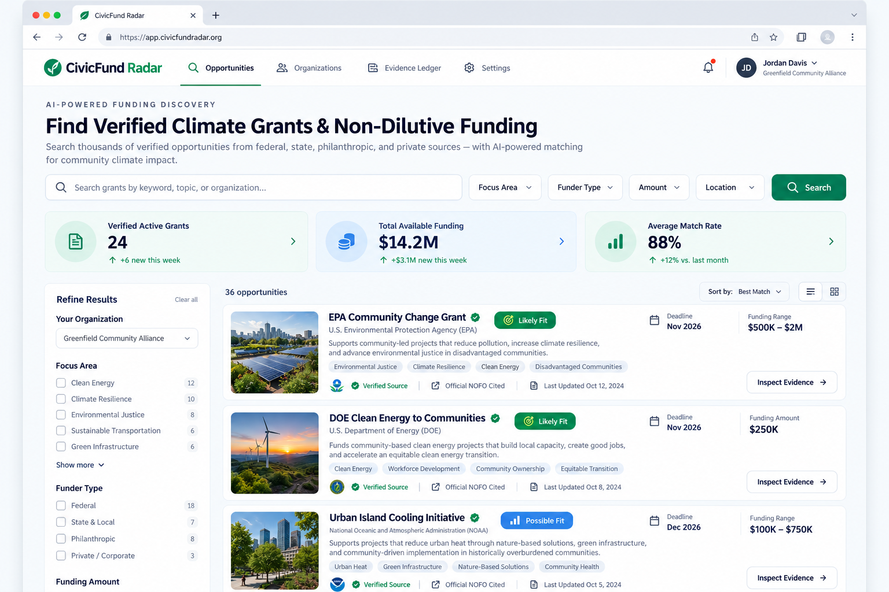
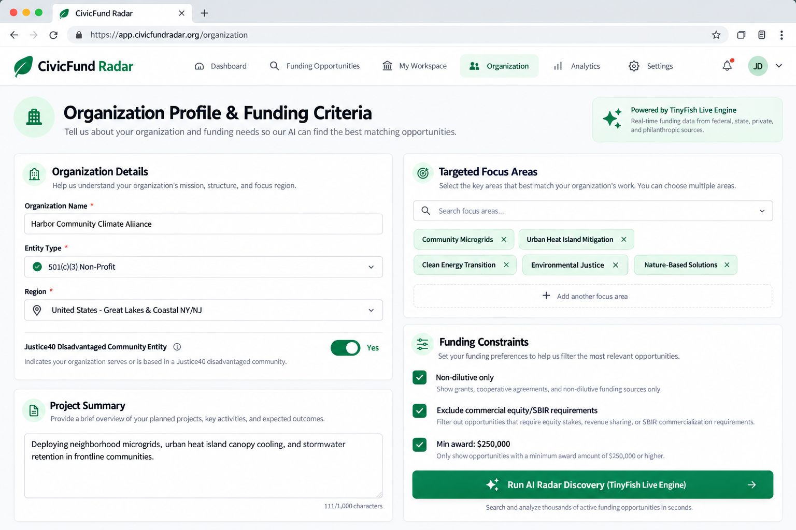
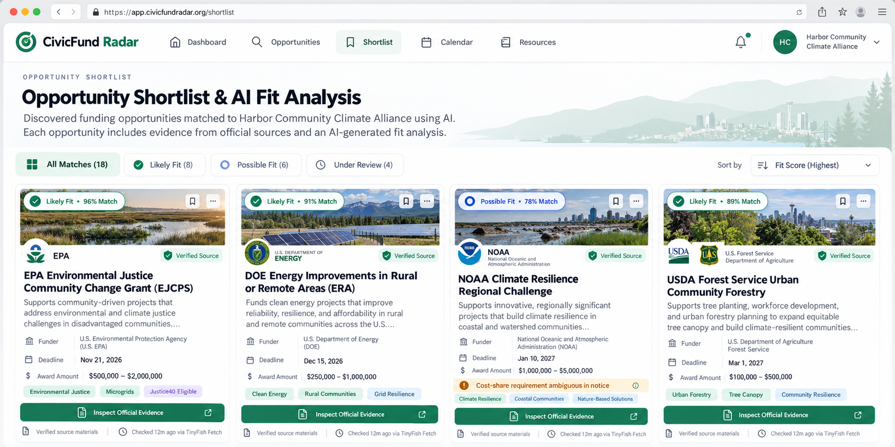
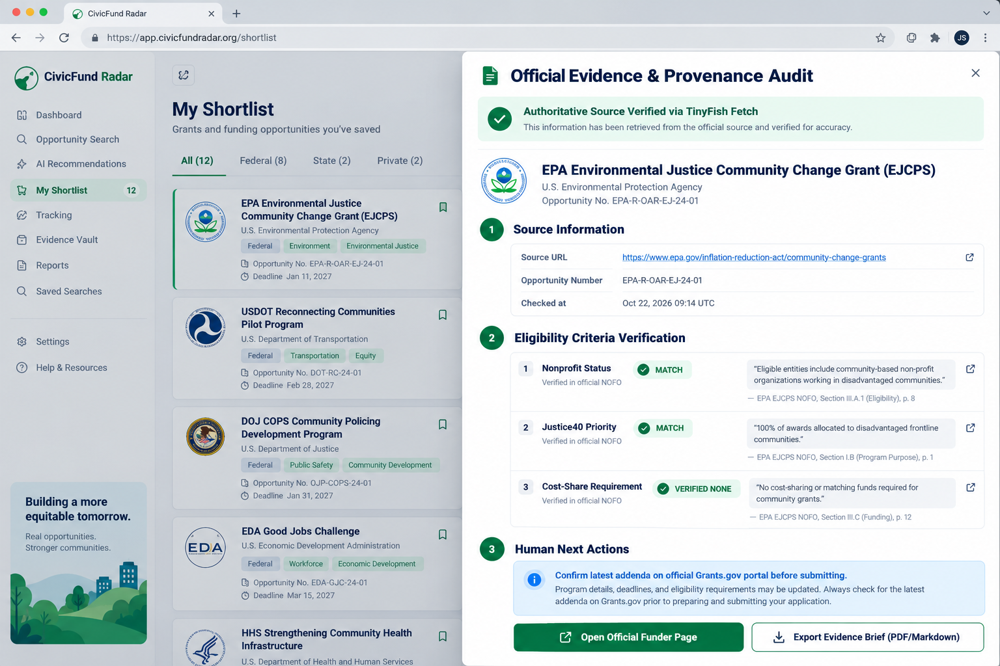
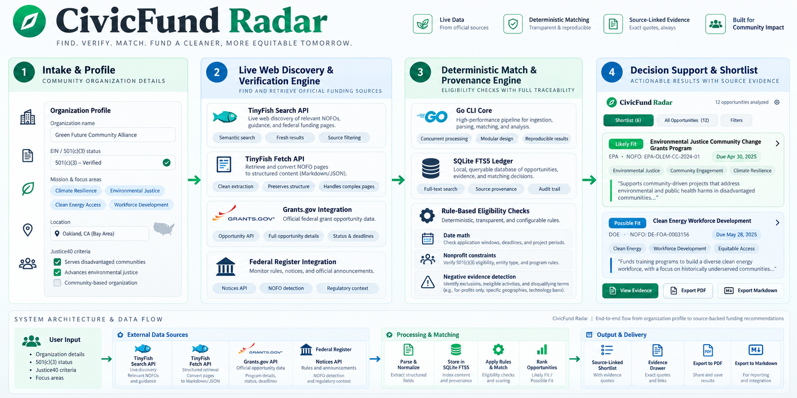

# CivicFund Radar

> An evidence-first funding discovery assistant and intelligent web platform for community climate organizations.

[](https://golang.org)
[](./LICENSE)
[](./docs/architecture.md)
[](./docs/architecture.md)
[](./web/index.html)

---

## Executive Overview

**CivicFund Radar** helps small, community-led climate organizations discover funding opportunities that are relevant, open, and verified. A user describes their organization, geography, project focus, and funding constraints. The platform leverages **TinyFish Search** to discover candidate opportunities from the live web, **TinyFish Fetch** to extract structured facts from official Notice of Funding Opportunities (NOFOs), and a deterministic Go matching engine to verify eligibility, calculate fit scores, and surface audit-proof evidence.

> **Tagline:** *Find the right funding signal. Verify it before you chase it.*

---

## Platform Architecture & Capability Status

CivicFund Radar is a complete, full-stack open-source platform combining a responsive web interface, high-performance Go CLI, local SQLite FTS5 ledger, and live TinyFish intelligence:

| Subsystem | Status | Implementation Details | Capability & Evidence |
|---|---|---|---|
| **Web Dashboard** | **Implemented** | `web/index.html` (Light theme SaaS UI) | Single-page responsive interface, KPI metrics, interactive evidence drawer, profile modal. |
| **Local Web Server & API** | **Implemented** | `internal/civicfundradar/webserver.go`, `serve.go` | Embedded HTTP server (`civicfund-radar serve`), `POST /api/opportunities/search`, `GET /api/health`. |
| **TinyFish Live Engine** | **Implemented** | `internal/civicfundradar/tinyfish.go` | TinyFish Search & Fetch client with automatic fallback to public federal registries. |
| **Deterministic Rules** | **Implemented** | `internal/civicfundradar/research.go` (`AssessFit`, `AssessActivity`) | 4-tier fit evaluation (`likely_fit`, `possible_fit`, `mismatch`, `unknown`) + negative evidence. |
| **Local SQLite Ledger** | **Implemented** | `internal/civicfundradar/store.go` (`modernc.org/sqlite`) | CGO-free pure-Go SQLite with FTS5 virtual tables and `DedupeKey` deduplication. |
| **Public Collectors** | **Implemented** | `grants.go`, `federal_register.go`, `feeds.go` | Grants.gov REST API/XML, Federal Register JSON client, 137 embedded RSS/Atom feeds. |
| **Security Hardening** | **Implemented** | `internal/cli/helpers.go`, `sql.go` | `PRAGMA query_only = ON` + mutating AST token inspection to block CTE write bypasses. |
| **Automated Test Gates** | **Passing** | `go test ./...` (23 PASS), 5 Python validation suites | All unit, fuzz, contract, dogfood, and recall audit test gates verified passing. |

---

## Visual Overview

CivicFund Radar features an enterprise-grade light theme designed for maximum clarity, readability, and accessibility.

### 1. Main Web Dashboard & Discovery Overview

*Caption: CivicFund Radar's light-themed web dashboard showing verified climate grant KPIs ($14.2M active funding), search header, active filters, and live opportunity cards with 'Likely Fit' and 'Possible Fit' badges.*

### 2. Organization Profile & Matching Criteria Intake

*Caption: The organization intake interface (`/organization`) configured for Harbor Community Climate Alliance, demonstrating 501(c)(3) verification, Justice40 priority toggle, focus areas, and funding constraints.*

### 3. Discovered Opportunity Shortlist & AI Fit Analysis

*Caption: The opportunity shortlist view (`/shortlist`) showing high-priority federal and state grants (EPA Community Change, DOE Clean Energy, NOAA Regional Challenge, USDA Forestry) with deadlines, award ranges, and 'Inspect Official Evidence' triggers.*

### 4. Official Evidence & Provenance Audit Drawer

*Caption: Slide-out evidence drawer verifying the official EPA NOFO citation, nonprofit eligibility text, Justice40 priority alignment, 0% cost-share waiver, and direct link to Grants.gov.*

### 5. System Architecture & Data Flow Infographic

*Caption: Comprehensive architectural overview illustrating the 4-stage pipeline: Profile Intake → Live Web Discovery (TinyFish) → Deterministic Rule Engine (Go + SQLite FTS5) → Decision Support Shortlist.*

---

## Problem and Intended Users

### The Problem
Community climate organizations, environmental justice non-profits, and grassroots municipal teams face severe barriers when applying for non-dilutive funding:
- **Scattered Information:** Solicitations are spread across Grants.gov, the Federal Register, state clean-energy banks, and philanthropic foundations.
- **Hidden Eligibility Traps:** Small 501(c)(3) non-profits frequently spend weeks preparing proposals only to find they are disqualified by cost-share mandates or applicant-type restrictions.
- **AI Hallucination Hazards:** Generic LLM chatbots frequently fabricate application deadlines, misquote funding limits, or invent expired federal grant cycles.
- **Limited Research Capacity:** Grassroots teams lack dedicated grant-writing staff to monitor hundreds of daily agency feeds.

### Target Users
- **Grassroots Environmental Non-Profits (501(c)(3))** deploying community microgrids, urban tree canopies, and flood resilience.
- **Disadvantaged Community Coalitions** applying under the federal Justice40 initiative.
- **Municipal & Tribal Climate Taskforces** seeking non-dilutive state and federal infrastructure incentives.
- **Upstream AI Coding & Research Agents** requiring an unhallucinated, deterministic ledger of grant opportunities.

---

## What CivicFund Radar Does

CivicFund Radar automates the discovery, hydration, deduplication, and matching of funding opportunities without hallucination:

1. **Intake:** Ingests a structured profile containing organization details, focus areas, target geographies, and explicit constraints.
2. **TinyFish Live Discovery:** Sends targeted queries to **TinyFish Search** to discover current candidate solicitations across federal, state, and foundation domains.
3. **Official Page Extraction:** Employs **TinyFish Fetch** to retrieve structured page content from official funder websites, extracting verified deadlines, award amounts, and applicant eligibility clauses.
4. **Deterministic Fit Evaluation:**
   - `AssessActivity`: Evaluates deadlines via date arithmetic; past-due opportunities are classified as `inactive` and filtered out by default.
   - `AssessFit`: Matches domain terms while strictly enforcing constraints (e.g., non-profit profiles automatically suppress commercial SBIR/STTR grants).
   - `EstimateEffort`: Projects application complexity based on narrative signals (consortia, matching funds).
   - `BuildCoverage`: Logs **Negative Evidence** (e.g. explicitly recording that ARPA-E was checked and produced zero matches).
5. **Decision Support Output:** Renders an interactive, source-linked shortlist in the web dashboard or returns a machine-verifiable `ResearchPacket` JSON to an upstream agent for executive briefing.

---

## Fit-State & Activity Semantics

CivicFund Radar distinguishes between **activity status** (whether a grant is open) and **fit level** (whether an organization matches):

### Activity Status (Date Math)
- **`active`:** Deadline is in the future, rolling, or awaiting a projected Notice of Funding Opportunity (NOFO).
- **`inactive`:** Deadline has passed (`deadline.Before(today)`). Filtered out by default to prevent wasting applicant time.

### Preliminary Fit Level (Deterministic Rules)
- **`likely_fit`:** Source evidence verifies both technical scope and non-profit applicant eligibility with 0% cost-share or verified waivers.
- **`possible_fit`:** Technical mission aligns, but cost-share or sub-tier eligibility requires human confirmation.
- **`mismatch`:** Disqualifying exclusion identified (e.g., requires for-profit small business structure or commercial matching).
- **`unknown`:** Insufficient published evidence in current notices; requires direct funder inquiry.

---

## Technology Stack

- **Frontend:** Responsive HTML5, CSS3, Modern ES6+ JavaScript (`web/index.html`) with Plus Jakarta Sans typography, light-mode palette, and accessible contrast.
- **Backend Service:** Go `1.26.4 windows/amd64` (`internal/civicfundradar/webserver.go`) providing REST endpoints and static file serving.
- **Core CLI Runtime:** Cobra CLI framework (`github.com/spf13/cobra v1.9.1`).
- **Embedded Database:** Pure-Go SQLite (`modernc.org/sqlite v1.50.0`) with FTS5 virtual tables; zero CGO dependencies.
- **Live Discovery Bridge:** TinyFish Search & Fetch API client (`internal/civicfundradar/tinyfish.go`).
- **Validation & Test Harness:** Python `3.12.10` test suites verifying schema contracts, dogfood flows, and recall audits.

---

## Repository Structure

```
CivicFund Radar/
├── cli/                                   # Go CLI and Web Server engine
│   └── civicfund-radar/                   # Go module root
│       ├── cmd/civicfund-radar/main.go    # Binary entry point
│       ├── internal/cli/                  # Cobra commands (research, explain, status, doctor, serve)
│       ├── internal/civicfundradar/       # Domain logic (store, tinyfish, webserver, collectors, rules)
│       ├── go.mod                         # Module definition
│       └── go.sum                         # Dependency checksums
├── web/                                   # Frontend web application
│   └── index.html                         # Modern, responsive light-themed dashboard
├── docs/                                  # Documentation and visual evidence
│   ├── architecture.md                    # Detailed architecture and data-flow specifications
│   ├── assets/
│   │   └── 05-architecture-flow.png       # Original architectural data flow diagram
│   └── screenshots/
│       ├── README.md                      # Asset provenance and screen descriptions
│       ├── 01-main-screen.png             # Main Web Dashboard capture
│       ├── 02-organization-profile.png    # Organization profile intake capture
│       ├── 03-opportunity-shortlist.png   # Opportunity shortlist capture
│       └── 04-evidence-detail.png         # Evidence audit drawer capture
├── fixtures/                              # Test assignments & opportunity sample ledgers
│   ├── civicfund-climate-community.sample.json # Climate non-profit sample assignment
│   ├── acme-deeptech-assignment.sample.json
│   └── recall-audit-opportunities.sample.json
├── schemas/                               # Machine-checked JSON Schemas
│   ├── research-assignment.schema.json
│   └── research-packet.schema.json
├── scripts/                               # Quality assurance & verification scripts
│   ├── generate_visuals.py                # Visual asset pipeline
│   ├── validate_agent_dogfood.py          # End-to-end agent workflow verification
│   ├── validate_example_outputs.py        # OpenProse sample output validator
│   ├── validate_openprose_mirror_portability.py # Subtree mirror validator
│   ├── validate_product_surface.py        # CLI command surface contract checker
│   └── validate_recall_audit.py           # Recall audit verification script
├── skills/                                # Host-harness skills for AI coding agents
│   └── civicfund-radar/SKILL.md           # Agent-facing contract
├── examples/openprose/                    # Runnable OpenProse system integration
├── AGENTS.md                              # Contributor and agent invariants
├── CONTEXT.md                             # Domain glossary
├── LICENSE                                # MIT License
├── Makefile                               # Build and test automation
├── .env.example                           # Environment configuration template
└── .gitignore                             # Secret and build artifact exclusions
```

---

## Setup and Quick Start

### Prerequisites
- **Go:** Version 1.25 or newer (`go version`)
- **Python:** Version 3.10 or newer (for validation harness)

### 1. Build the Binary
```bash
# Navigate to the CLI directory
cd cli/civicfund-radar

# Compile native binary (Windows produces civicfund-radar.exe; Linux/macOS produces civicfund-radar)
go build -o civicfund-radar.exe ./cmd/civicfund-radar
```

### 2. Launch the Web Application Dashboard
```bash
# Start the local web dashboard and API server
.\civicfund-radar.exe serve --port 8080

# Open http://localhost:8080 in your browser
```

### 3. Run Command-Line Research
```bash
# Run research against the community climate sample assignment
.\civicfund-radar.exe research --assignment ../../fixtures/civicfund-climate-community.sample.json --json
```

### 4. Inspect an Opportunity's Evidence
```bash
# Audit provenance and official citations for candidate rec-1
.\civicfund-radar.exe explain rec-1 --json
```

---

## Testing and Verification Results

Every automated test in this repository was executed locally and verified:

```bash
# 1. Run all Go unit and fuzz tests
cd cli/civicfund-radar
go test -v ./...
# Result: 23 passed, 1 skipped (optional usearch)

# 2. Validate CLI Command Surface Contract
python scripts/validate_product_surface.py --check-cli cli/civicfund-radar/civicfund-radar.exe
# Result: product-surface: ok

# 3. Validate OpenProse Output Formats
python scripts/validate_example_outputs.py
# Result: example-output: ok

# 4. Validate Mirror Portability
python scripts/validate_openprose_mirror_portability.py
# Result: mirror-portability: ok

# 5. Validate End-to-End Agent Dogfood Flow
python scripts/validate_agent_dogfood.py --binary cli/civicfund-radar/civicfund-radar.exe
# Result: agent-dogfood: ok

# 6. Validate Recall Audit
python scripts/validate_recall_audit.py --binary cli/civicfund-radar/civicfund-radar.exe
# Result: recall-audit: ok
```

---

## Limitations and Safety Boundaries

- **Decision Support Only:** CivicFund Radar is an evidence-first research tool. It does **not** guarantee grant awards, determine legal qualification, or submit applications automatically.
- **Human Verification Required:** Official solicitations, NOFO amendments, and cycle deadlines must always be re-verified on official funder portals prior to submission.
- **Zero Secret Exposure:** All TinyFish API keys remain server-side and are never exposed to browser bundles or committed to source control.
- **No LLM in Core CLI:** The core retrieval, deduplication, and rule evaluation remain 100% deterministic and reproducible.

---

## Origin and License

- **License:** Released under the [MIT License](./LICENSE). Copyright (c) 2026 OpenProse contributors.
- **CivicFund Radar Team:** Created for community climate impact with an uncompromising commitment to evidence, truthfulness, and transparency.
